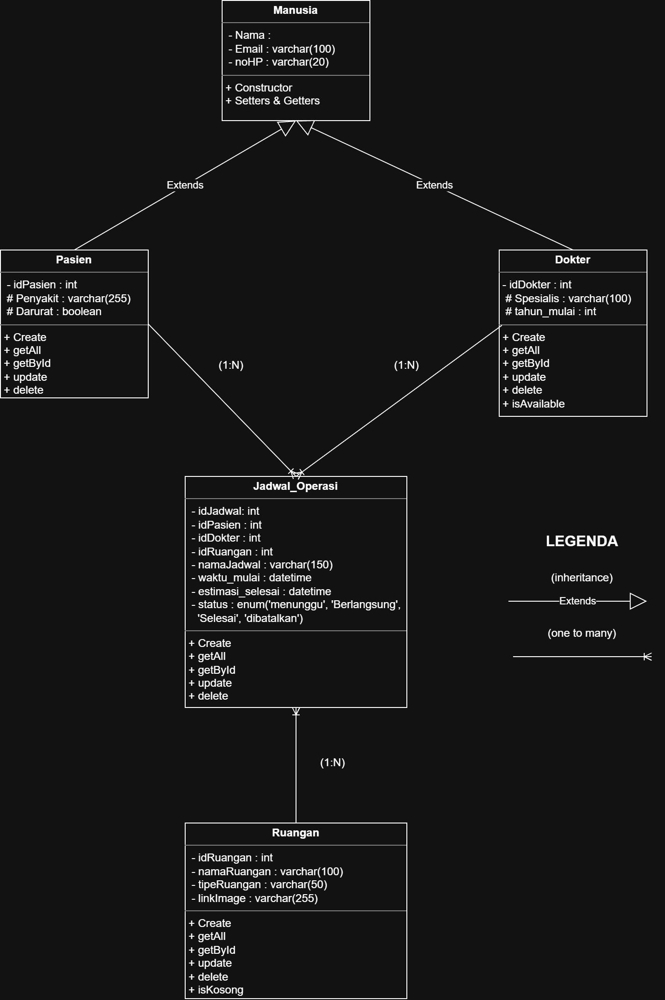

# Janji

Saya Faridchi Trianda Safaraz dengan NIM 2506827 mengerjakan Tugas Praktikum 7 pada Mata Kuliah Desain dan Pemrograman Berorientasi Objek (DPBO) untuk keberkahan-Nya maka saya tidak melakukan kecurangan seperti yang telah dispesifikasikan. Aamiin

# Sistem Penjadwalan Operasi Rumah Sakit THB

Aplikasi web berbasis PHP (OOP) untuk mengelola penjadwalan operasi di sebuah rumah sakit fiktif bernama **Rumah Sakit THB**. Sistem ini mencatat data pasien, dokter, dan ruang operasi, lalu menghubungkan ketiganya dalam sebuah jadwal operasi yang otomatis dicek agar **tidak bentrok** (ruangan tidak terisi ganda dan dokter tidak punya dua operasi di jam yang sama).

## Tema Website

Tema website adalah **manajemen rumah sakit, khususnya penjadwalan tindakan bedah**. Pengguna (staf rumah sakit) dapat:

- Mendaftarkan pasien beserta diagnosa dan status triage (**Normal** atau **Darurat**). Pasien darurat selalu tampil paling atas pada daftar.
- Mengelola dokter spesialis beserta tahun mulai praktik (lama pengalaman dihitung otomatis).
- Mengelola ruang operasi lengkap dengan **foto ruangan** yang diunggah ke folder `img/`.
- Membuat jadwal operasi yang menghubungkan pasien, dokter, dan ruangan, serta memantau statusnya (`Menunggu` → `Berlangsung` → `Selesai`, atau `Dibatalkan`).

## Fitur Utama

Sistem menyediakan CRUD (Create, Read, Update, Delete) lengkap untuk empat tabel:

| Menu | Fungsi |
|------|--------|
| **Data Pasien** | Nama, email, no. HP, penyakit/diagnosa, dan status triage darurat. |
| **Data Dokter** | Nama dan gelar, spesialis, tahun mulai praktik, no. HP, email. |
| **Ruang Operasi** | Nama ruangan, tipe/fasilitas, dan upload foto (jpg, jpeg, png, webp, gif). Jika tidak upload, dipakai `img/default.jpg`. |
| **Jadwal Operasi** | Memilih pasien, dokter, ruangan, nama tindakan, waktu mulai dan estimasi selesai. Status dapat diubah cepat lewat tombol **Mulai**, **Selesai**, **Batal**. |

Fitur tambahan:

- **Validasi waktu:** waktu mulai harus lebih awal dari estimasi selesai.
- **Deteksi bentrok ruangan** (`Ruangan::isKosong`) dan **bentrok dokter** (`Doctor::isAvailable`), baik saat membuat maupun mengedit jadwal. Jadwal berstatus `Selesai` atau `Dibatalkan` tidak dihitung sebagai bentrok.
- **Notifikasi (flash message)** berbasis session setelah setiap aksi, berwarna hijau (berhasil) atau merah (gagal).
- **Prepared statement (PDO)** pada semua query untuk mencegah SQL injection, dan `htmlspecialchars` pada semua output untuk mencegah XSS.
- **Home dashboard** yang menampilkan total data tiap modul.

## Struktur Proyek

Proyek menggunakan pola sederhana mirip MVC: folder `class/` berperan sebagai **Model** (logika dan query database), folder `view/` sebagai **View** (tampilan), dan `index.php` sebagai **Controller** sekaligus router.

```
Main
├── Program
│   ├── class/
│   │   ├── Manusia.php            
│   │   ├── Pasien.php             
│   │   │   ├── create()
│   │   │   ├── getAll()
│   │   │   ├── getById($id)
│   │   │   ├── update()
│   │   │   └── delete()
│   │   ├── Doctor.php             
│   │   │   ├── create()
│   │   │   ├── getAll()
│   │   │   ├── getById($id)
│   │   │   ├── update()
│   │   │   ├── delete()
│   │   │   └── isAvailable()
│   │   ├── Ruangan.php
│   │   │   ├── create()
│   │   │   ├── getAll()
│   │   │   ├── getById($id)
│   │   │   ├── update()
│   │   │   ├── delete()
│   │   │   └── isKosong()
│   │   └── JadwalOperasi.php
│   │       ├── create()
│   │       ├── getAll()
│   │       ├── getById($id)
│   │       ├── update()
│   │       ├── updateStatus()
│   │       └── delete()
│   │
│   ├── config/
│   │   └── db.php                 
│   │
│   ├── database/
│   │   └── db_rumahsakit.sql      
│   │
│   ├── img/                       
│   │
│   ├── view/
│   │   ├── header.php
│   │   ├── footer.php
│   │   ├── home.php
│   │   ├── jadwal.php
│   │   ├── pasien.php
│   │   ├── doctor.php
│   │   └── ruangan.php
│   │
│   ├── index.php                  
│   └── style.css
│
├── Dokumentasi
│   ├── Diagram.png
│   └── dokumentasitp7.mp4
│
└── README.md
```

## Konsep OOP yang Digunakan

- **Abstraction dan Inheritance:** `Manusia` adalah abstract class yang menyimpan atribut umum (`nama`, `email`, `no_hp`) dan koneksi database. `Pasien` dan `Doctor` mewarisinya (`extends Manusia`).
- **Encapsulation:** atribut bersifat `protected` atau `private` dan diakses lewat getter dan setter.
- **Komposisi:** `JadwalOperasi` memakai objek `Doctor` dan `Ruangan` untuk memvalidasi bentrok sebelum menyimpan data.

## Diagram



Diagram menunjukkan `Pasien` dan `Dokter` sebagai turunan `Manusia`. `Jadwal_Operasi` terhubung ke `Pasien`, `Dokter`, dan `Ruangan` dengan relasi one-to-many (1:N), yaitu satu pasien, dokter, atau ruangan dapat muncul di banyak jadwal.

## Database

```sql
DROP DATABASE IF EXISTS db_rumahsakit;
CREATE DATABASE db_rumahsakit;
USE db_rumahsakit;

-- 1. Tabel Pasien (Extends Manusia di OOP)
CREATE TABLE pasien (
    id INT AUTO_INCREMENT PRIMARY KEY,
    nama VARCHAR(100) NOT NULL,
    email VARCHAR(100),
    no_hp VARCHAR(20),
    penyakit VARCHAR(255) NOT NULL,
    darurat TINYINT(1) NOT NULL DEFAULT 0
);
-- 2. Tabel Doctor (Extends Manusia di OOP)
CREATE TABLE doctor (
    id INT AUTO_INCREMENT PRIMARY KEY,
    nama VARCHAR(100) NOT NULL,
    spesialis VARCHAR(100) NOT NULL,
    tahun_mulai INT NOT NULL,
    no_hp VARCHAR(20),
    email VARCHAR(100)
);
-- 3. Tabel Ruangan (Memiliki kolom img VARCHAR yang mengarah ke path lokal img/)
CREATE TABLE ruangan (
    id INT AUTO_INCREMENT PRIMARY KEY,
    nama_ruangan VARCHAR(100) NOT NULL,
    tipe_ruangan VARCHAR(50) NOT NULL DEFAULT 'Operasi Umum',
    img VARCHAR(255) NOT NULL DEFAULT 'img/default.jpg'
);
-- 4. Tabel Jadwal Operasi (Relasi / Transaksi)
CREATE TABLE jadwal_operasi (
    id INT AUTO_INCREMENT PRIMARY KEY,
    pasien_id INT NOT NULL,
    doctor_id INT NOT NULL,
    ruangan_id INT NOT NULL,
    nama_jadwal VARCHAR(150) NOT NULL,
    waktu_mulai DATETIME NOT NULL,
    estimasi_selesai DATETIME NOT NULL,
    status ENUM('Menunggu', 'Berlangsung', 'Selesai', 'Dibatalkan') NOT NULL DEFAULT 'Menunggu',
    FOREIGN KEY (pasien_id) REFERENCES pasien(id) ON DELETE CASCADE,
    FOREIGN KEY (doctor_id) REFERENCES doctor(id) ON DELETE CASCADE,
    FOREIGN KEY (ruangan_id) REFERENCES ruangan(id) ON DELETE CASCADE
);
-- Seed Data Dummy Awal
INSERT INTO pasien (nama, email, no_hp, penyakit, darurat) VALUES
('Budi Santoso', 'budi@gmail.com', '081234567890', 'Apendisitis Akut', 1),
('Siti Rahma', 'siti@gmail.com', '082345678901', 'Katarak', 0),
('Ahmad Fauzi', 'ahmad@gmail.com', '083456789012', 'Fraktur Tulang Kering', 1);

INSERT INTO doctor (nama, spesialis, tahun_mulai, no_hp, email) VALUES
('dr. Tirta Wijaya, Sp.B', 'Spesialis Bedah Umum', 2015, '08111222333', 'tirta@hospital.com'),
('dr. Sarah Amelia, Sp.M', 'Spesialis Mata', 2018, '08222333444', 'sarah@hospital.com'),
('dr. Hendra Pratama, Sp.OT', 'Spesialis Orthopedi', 2012, '08333444555', 'hendra@hospital.com');

INSERT INTO ruangan (nama_ruangan, tipe_ruangan, img) VALUES
('Ruang Operasi Melati', 'Bedah Umum', 'img/melati.jpg'),
('Ruang Operasi Mawar', 'Bedah Mata', 'img/mawar.jpg'),
('Ruang Operasi Anggrek', 'Bedah Tulang (Orthopedi)', 'img/anggrek.jpg');

INSERT INTO jadwal_operasi (pasien_id, doctor_id, ruangan_id, nama_jadwal, waktu_mulai, estimasi_selesai, status) VALUES
(1, 1, 1, 'Operasi Usus Buntu (Apendektomi)', '2026-11-05 08:00:00', '2026-11-05 10:00:00', 'Menunggu'),
(2, 2, 2, 'Operasi Fakoemulsifikasi Katarak', '2026-11-05 10:30:00', '2026-11-05 12:00:00', 'Menunggu');
```

### Daftar Tabel

**1. `pasien`**: data pasien.

| Kolom | Tipe | Keterangan |
|-------|------|------------|
| `id` | INT, PK, AUTO_INCREMENT | ID pasien |
| `nama` | VARCHAR(100), NOT NULL | Nama pasien |
| `email` | VARCHAR(100) | Email |
| `no_hp` | VARCHAR(20) | Nomor telepon |
| `penyakit` | VARCHAR(255), NOT NULL | Diagnosa awal |
| `darurat` | TINYINT(1), NOT NULL, default 0 | 1 = darurat, 0 = normal |

**2. `doctor`**: data dokter.

| Kolom | Tipe | Keterangan |
|-------|------|------------|
| `id` | INT, PK, AUTO_INCREMENT | ID dokter |
| `nama` | VARCHAR(100), NOT NULL | Nama dan gelar |
| `spesialis` | VARCHAR(100), NOT NULL | Bidang spesialisasi |
| `tahun_mulai` | INT, NOT NULL | Tahun mulai praktik |
| `no_hp` | VARCHAR(20) | Nomor telepon |
| `email` | VARCHAR(100) | Email |

**3. `ruangan`**: data ruang operasi.

| Kolom | Tipe | Keterangan |
|-------|------|------------|
| `id` | INT, PK, AUTO_INCREMENT | ID ruangan |
| `nama_ruangan` | VARCHAR(100), NOT NULL | Nama ruangan |
| `tipe_ruangan` | VARCHAR(50), NOT NULL, default `Operasi Umum` | Tipe/fasilitas bedah |
| `img` | VARCHAR(255), NOT NULL, default `img/default.jpg` | Path foto ruangan di folder `img/` |

**4. `jadwal_operasi`**: tabel transaksi yang menghubungkan ketiga tabel di atas.

| Kolom | Tipe | Keterangan |
|-------|------|------------|
| `id` | INT, PK, AUTO_INCREMENT | ID jadwal |
| `pasien_id` | INT, NOT NULL, FK → `pasien(id)` | Pasien yang dioperasi |
| `doctor_id` | INT, NOT NULL, FK → `doctor(id)` | Dokter penanggung jawab |
| `ruangan_id` | INT, NOT NULL, FK → `ruangan(id)` | Ruang operasi yang dipakai |
| `nama_jadwal` | VARCHAR(150), NOT NULL | Nama tindakan/prosedur |
| `waktu_mulai` | DATETIME, NOT NULL | Waktu mulai operasi |
| `estimasi_selesai` | DATETIME, NOT NULL | Perkiraan waktu selesai |
| `status` | ENUM('Menunggu','Berlangsung','Selesai','Dibatalkan'), default `Menunggu` | Status operasi |

Ketiga foreign key memakai `ON DELETE CASCADE`: menghapus pasien, dokter, atau ruangan akan ikut menghapus jadwal operasi yang terkait.

### Relasi Antar Tabel

```
pasien (1) ───< jadwal_operasi >─── (1) doctor
                      │
                      └──── (1) ruangan
```

## Alur Kode (Flow)

### Alur umum

1. **Semua request masuk lewat `index.php`.** Di bagian atas, `index.php` menyalakan `session_start()`, memuat semua class model, dan membuat objek `Pasien`, `Doctor`, `Ruangan`, dan `JadwalOperasi`.
2. **Koneksi database** dibuat oleh class `Database` (`config/db.php`) menggunakan PDO. Mode error diset ke exception dan mode fetch ke array asosiatif. Class `Manusia`, `Ruangan`, dan `JadwalOperasi` membuat koneksi ini di constructor masing-masing.
3. **Pemrosesan aksi (sebelum HTML dirender).** `index.php` mengecek apakah ada aksi:
   - Aksi `POST` dari form: `add_*` dan `update_*`.
   - Aksi `GET`: `?page=...&action=delete&id=...` dan `?page=jadwal&action=set_status&id=...&status=...`.
4. Bila ada aksi, method model dipanggil, hasilnya disimpan di `$_SESSION['msg']` dan `$_SESSION['msg_type']`, lalu halaman di-**redirect** (`header("Location: ...")` + `exit`). Pola Post/Redirect/Get ini mencegah form terkirim ulang saat halaman di-refresh.
5. **Rendering halaman.** Parameter `?page=` (default `home`) menentukan view yang di-include: `home`, `jadwal`, `pasien`, `doctor`, atau `ruangan`. Header, navigasi, notifikasi, dan footer dirender di sekitarnya, dan notifikasi dihapus dari session setelah ditampilkan.
6. **Setiap view** mengambil data lewat model (`getAll()`), menampilkannya dalam tabel, dan memakai form yang sama untuk tambah maupun edit. Jika URL berisi `action=edit&id=...`, form diisi dengan data dari `getById()` dan tombol berubah menjadi "Simpan Perubahan".

### Alur CRUD per tabel

| Aksi | Pemicu | Method yang dipanggil |
|------|--------|-----------------------|
| **Create** | Submit form tambah (`add_pasien`, `add_doctor`, `add_ruangan`, `add_jadwal`) | `create()` |
| **Read** | Buka halaman `?page=...` | `getAll()` (dan `getById()` untuk form edit) |
| **Update** | Klik **Edit**, ubah data, submit (`update_*`) | `update()` |
| **Delete** | Klik **Hapus** lalu konfirmasi `confirm()` | `delete()` |

### Alur khusus: Ruangan (upload foto)

1. Form ruangan memakai `enctype="multipart/form-data"`.
2. Fungsi `uploadImageRuangan()` di `index.php` memeriksa upload dan memastikan ekstensi termasuk `jpg`, `jpeg`, `png`, `webp`, atau `gif`.
3. Nama file dibersihkan dari karakter aneh dan diberi awalan timestamp agar tidak menimpa file lama, misalnya `1793877179_contoh.jpg`. File disimpan di `img/`.
4. Path hasilnya (`img/nama_file`) disimpan ke kolom `ruangan.img`. Jika tidak ada upload, dipakai `img/default.jpg` (saat tambah) atau gambar lama lewat input hidden `existing_image` (saat edit).

### Alur khusus: Jadwal Operasi (cek bentrok)

Saat membuat jadwal (`JadwalOperasi::create`):

1. Cek `waktu_mulai < estimasi_selesai`. Jika tidak, tolak.
2. Cek ruangan lewat `Ruangan::isKosong()`. Jika ada jadwal aktif lain di ruangan itu yang tumpang tindih, tolak.
3. Cek dokter lewat `Doctor::isAvailable()`. Jika dokter punya jadwal aktif lain yang tumpang tindih, tolak.
4. Jika lolos semua, `INSERT` dengan status awal `Menunggu` dan tampilkan notifikasi sukses.

Rumus tumpang tindih yang dipakai: jadwal lama bentrok dengan jadwal baru bila `waktu_mulai_lama < estimasi_selesai_baru` **dan** `estimasi_selesai_lama > waktu_mulai_baru`. Jadwal berstatus `Selesai` atau `Dibatalkan` diabaikan.

Saat mengedit jadwal (`JadwalOperasi::update`), pengecekan yang sama dijalankan (dengan mengecualikan jadwal yang sedang diedit, lewat parameter `$exclude_jadwal_id`) selama status baru bukan `Selesai` atau `Dibatalkan`.

Tombol cepat di tabel mengubah status lewat `updateStatus()`:

```
Menunggu ──[Mulai]──> Berlangsung ──[Selesai]──> Selesai
    └────[Batal]────> Dibatalkan
```

## Dokumentasi

https://github.com/user-attachments/assets/1837b7fd-5f4b-4b69-8abf-85fe804ee29f
